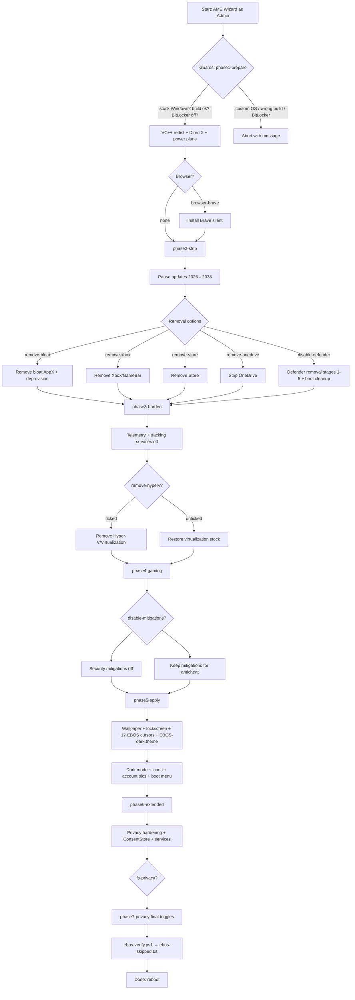

# EBOS [build 20261008.fb75f1]

Copyright (c) EBOS. Licensed under the PolyForm Noncommercial License 1.0.0 — see `LICENSE.txt`.

EBOS fully optimizes stock Windows for better responsiveness, max performance and zero tracking. This release is geared towards competitive gamers. Apply with AME Wizard in ~15 minutes.

## Requirements

- Stock Windows 10 22H2 (19044/19045) or Windows 11 23H2/24H2/25H2/26H2 (22631/26100/26200/26300)
- No pending updates, no third-party antivirus, BitLocker off, plugged in, internet connected (VC++ redist + optional Brave download)

## Package layout

```
EBOS-11H2-release-r11/
├── playbook.conf            # wizard UI, options, supported builds
├── playbook.png             # wizard banner
├── BUILD-INFO.txt           # build id + applied steps
├── LICENSE.txt              # Copyright (c) EBOS + PolyForm terms
├── README.md                # this file
├── Configuration/
│   ├── main.yml             # Admin: phase1 → phase7
│   └── Tasks/
│       ├── phase1-prepare.yml
│       ├── phase2-strip.yml
│       ├── phase3-harden.yml
│       ├── phase4-gaming.yml
│       ├── phase5-apply.yml
│       ├── phase6-extended.yml
│       └── phase7-privacy.yml
├── Executables/             # scripts, theme, icons, images, dxredist, cursors/
│   ├── ebos-dark.theme      # EBOS Dark (#3778B5 / #14263F)
│   ├── ebos-verify.ps1      # post-apply check → %WINDIR%\EBOS\ebos-skipped.txt
│   ├── restore-personalization.ps1  # logon guard (cursors + wallpaper)
│   ├── cursors/             # 17x ebos-*.ani
│   ├── dxredist/            # DirectX runtime (DXSETUP.exe /silent)
│   ├── wallpaper.png / lockscreen.png / profile.png
│   └── ebos.ico / discord.ico (real ICO)
└── Images/
    └── brave.png            # browser option icon
```

## Install flowchart



## Options (playbook.conf)

| Option | Effect |
|---|---|
| `browser-brave` | Install Brave silently |
| `remove-bloat` | Remove bloatware AppX + provisioned |
| `remove-xbox` | Remove Xbox + GameBar |
| `remove-store` | Remove Microsoft Store |
| `remove-edge` | Remove Edge |
| `remove-ai` | Remove Copilot/Recall |
| `remove-onedrive` | Strip OneDrive + scheduled tasks |
| `remove-hyperv` | Remove Hyper-V/Virtualization (breaks WSL/VMs/emulators) |
| `disable-defender` | Remove Defender + SmartScreen (reboot required) |
| `disable-mitigations` | VBS/HVCI off, vulnerable-driver blocklist off |
| `disable-power-saving` | Ultimate Performance plan, hibernate off |
| `disable-auto-driver-updates` | Exclude drivers from Windows Update |
| `disable-printing` | Printing stack off |
| `disable-webview2` | Remove WebView2 |
| `disable-wifi` | Wi-Fi stack off |
| `disable-bluetooth` | Bluetooth stack off |
| `disable-location` | Location + Maps off |
| `disable-storage-sense` | Storage Sense off |
| `remove-accessibility` | Accessibility features removed |
| `fs-privacy` | Extra privacy hardening (phase7) |
| `fs-wallpaper` | EBOS wallpaper + lockscreen + cursors + theme |
| `fs-darkmode` | Dark mode + EBOS-dark.theme deploy |
| `fs-noanimations` | Animation effects off |
| `fs-notransparency` | Transparency effects off |
| `fs-w10-context` | Windows 10 context menu |
| `fs-w10-taskbar` | Windows 10 taskbar |
| `fs-w10-tbleft` | Left taskbar alignment |
| `fs-small-icons` | Small desktop icons |

## Verification

After apply, `ebos-verify.ps1` re-reads every declared registry value, key, service, task, AppX entry and file (theme content, 17 cursors, ICO headers). Anything that did not take is logged to `%WINDIR%\EBOS\ebos-skipped.txt`. Gated options that were unticked count as not-applicable, not failures.

## Notes

- Defender removal is destructive and needs the reboot notice; re-enable only via stock reinstall path.
- `disable-mitigations` + most anticheats don't mix — leave mitigations on for competitive games.
- Personalization guard runs at each logon and repairs only what Windows reset (26H2 regression).
